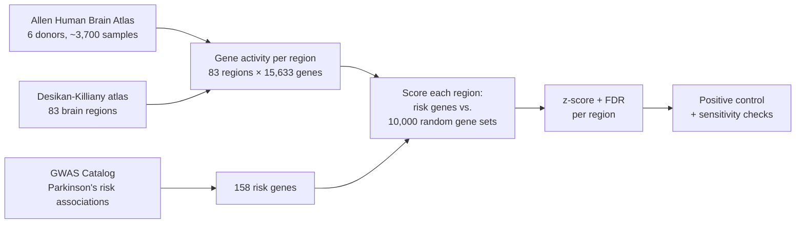

# Are Parkinson's risk genes more active where the disease strikes?

Parkinson's disease destroys specific parts of the brain first, mainly the dopamine system feeding the **striatum** (caudate and putamen), with pathology thought to start in the **brainstem**. Yet the genes that raise Parkinson's risk are present in every cell of the body. Why does the damage land in some brain regions and not others?

One possible answer: risk genes might simply be **more active** in the regions that get damaged. This project tests that idea with public data from healthy human brains.


## Key findings

- **No brain region shows unusually high activity of Parkinson's risk genes.** 0 of 83 regions pass correction for multiple testing. 3 are nominally significant, against about 4 expected by chance.
- **The regions Parkinson's hits hardest rank lowest, not highest.** Caudate and putamen sit at the very bottom (z ≈ −1.3 to −1.6), and the brainstem is exactly average (z ≈ 0).
- **The method does find real signals.** A positive control with known striatum genes lights up the caudate and putamen at z ≈ 5–6.
- **The result is robust.** It holds after removing the complex MHC/MAPT/LRRK2 loci, and after leaving out each of 93 genomic loci in turn.

**Conclusion:** in healthy adult brains, *regional* activity of Parkinson's risk genes does not explain where the disease strikes. That points toward properties of specific cell types (such as the very high energy demands of dopamine neurons) rather than whole regions.

---

## How it works



1. **Brain data.** The [Allen Human Brain Atlas](https://human.brain-map.org/) measured the activity of every gene at thousands of points in six donated brains. [`abagen`](https://abagen.readthedocs.io/) maps those samples onto 83 named brain regions.
2. **Risk genes.** Parkinson's risk associations come from the [GWAS Catalog](https://www.ebi.ac.uk/gwas/efotraits/MONDO_0005180) (p < 5×10⁻⁸). Cleaning them leaves **158 protein-coding genes** that are measured in the brain data, including SNCA, LRRK2, GBA1, MAPT and TMEM175.
3. **Scoring.** For each region, the average activity of the 158 risk genes is compared with **10,000 random sets of 158 genes**. The z-score says how far above "random" the risk genes sit. p-values are corrected for testing 83 regions (Benjamini–Hochberg FDR).
4. **Checks.** A positive control, plus re-scoring with loci removed, tests whether the result can be trusted.

## Results

### 1. The method works: positive control

Before asking about Parkinson's, I checked that the pipeline can find a known signal. Seven classic striatum marker genes (dopamine receptors DRD1/DRD2 and their partners) should light up the striatum, and they do:


| Region (mean of left and right) | z | FDR q |
|---|---|---|
| Caudate | 6.4 | 0.002 |
| Putamen | 5.4 | 0.002 |
| Nucleus accumbens | 3.1 | 0.01 |

So when a real regional signal exists, this pipeline finds it.

### 2. Parkinson's risk genes: no regional enrichment

Even the best-scoring region (right superior frontal cortex, z = 1.9) sits inside the range of what random gene sets produce:


| Region (mean of left and right) | Damaged in Parkinson's? | z | FDR q |
|---|---|---|---|
| Superior frontal (top region) | Late / not typically | 1.90 | 0.45 |
| Entorhinal | Mid-stage (Braak 4) | 1.19 | 0.45 |
| Hippocampus | Mid-stage | 1.16 | 0.45 |
| Amygdala | Early (Braak 3) | 0.60 | 0.50 |
| Brainstem | **Earliest (Braak 1–2)** | −0.02 | 0.62 |
| Putamen | **Core target** (loses dopamine input) | −1.32 | 0.93 |
| Caudate | **Core target** | −1.62 | 0.95 |

Full table for all 83 regions: [`results/tables/region_scores.csv`](results/tables/region_scores.csv)

### 3. Robustness

| Check | Result |
|---|---|
| Remove MHC, MAPT and LRRK2 genes (8 genes) | Region ranking unchanged (Spearman ρ = 0.98) |
| Leave out each of 93 genomic loci, one at a time | Ranking always holds (ρ ≥ 0.93), top-10 overlap averages 86% |
| Highest z across all 94 sensitivity runs | 2.22, still not significant after correction |
| Caudate and putamen | Negative in every run |
| Re-running the pipeline | Byte-identical results (fixed random seed) |

## Limitations

- **Six donors.** The Allen atlas has six brains, all from adults without Parkinson's. It shows where genes are active in *healthy* brains, which isn't necessarily where they matter during disease.
- **Hemisphere mirroring.** Only 2 of 6 donors have right-hemisphere samples, so samples are mirrored across hemispheres. Left and right are therefore nearly identical (r = 0.98).
- **No substantia nigra.** The Desikan-Killiany atlas has a single brainstem region and no separate substantia nigra, the structure Parkinson's destroys first.
- **Region averages hide cell types.** Each region mixes many cell types. A signal confined to one cell type, such as dopamine neurons, can disappear in the average.
- **Nearest-gene mapping.** A GWAS hit sits *near* a gene, which doesn't prove that gene is the cause. 26 protein-coding risk genes (e.g. BST1, GCH1) had no reliable probe in brain tissue and were left out.
- **Gene co-expression.** Random gene sets ignore the fact that related genes are switched on together, which can make the null too narrow. This would favour finding *false positives*, so it doesn't weaken a null result.

## Status

| Step | Status |
|---|---|
| 1. Environment | ✅ Done |
| 2. Brain expression data (83 regions × 15,633 genes) | ✅ Done |
| 3. Parkinson's risk gene list (158 genes) | ✅ Done |
| 4. Positive control | ✅ Passed |
| 5. Region scoring + sensitivity checks | ✅ Done (null result) |
| 6. Braak staging trend: does activity follow the order Parkinson's spreads in? | ⏳ Code drafted (`src/braak.py`), not run |
| 7–8. Compare with patients' cortical-thinning map, using spatial (spin) null models | ⏳ Code drafted (`src/spatial_test.py`), not run |

## Reproduce

Requires Python 3.11 and about 4.5 GB of free disk space for the brain data.

```powershell
python -m venv .venv
.venv\Scripts\python.exe -m pip install -r requirements.txt
.venv\Scripts\python.exe run_pipeline.py
```

The first run downloads the Allen Human Brain Atlas (~4 GB) into `data/raw/`. Later runs reuse it and take about a minute. The GWAS Catalog snapshot used for these results is included at [`data/raw/gwas_pd_associations.tsv`](data/raw/gwas_pd_associations.tsv).

## Repository structure

```
├── run_pipeline.py          # reproduces every result and figure
├── requirements.txt
├── src/
│   ├── config.py            # every analysis choice in one place
│   ├── fetch_expression.py  # Allen brain data -> 83 regions x genes
│   ├── fetch_gwas.py        # GWAS hits -> cleaned risk gene list
│   ├── score_regions.py     # permutation test, FDR, sensitivity checks
│   ├── plots.py             # figures
│   ├── braak.py             # (next step) Braak staging trend
│   └── spatial_test.py      # (next step) atrophy comparison with spin nulls
├── results/tables/          # region scores, gene list, sensitivity runs
├── figures/
└── data/raw/                # GWAS snapshot (brain data downloaded on first run)
```

## References

- Hawrylycz MJ et al. (2012). An anatomically comprehensive atlas of the adult human brain transcriptome. *Nature*. ([Allen Human Brain Atlas](https://human.brain-map.org/))
- Markello RD et al. (2021). Standardizing workflows in imaging transcriptomics with the abagen toolbox. *eLife*. https://elifesciences.org/articles/72129
- Desikan RS et al. (2006). An automated labeling system for subdividing the human cerebral cortex on MRI scans into gyral based regions of interest. *NeuroImage*.
- Sollis E et al. (2023). The NHGRI-EBI GWAS Catalog. *Nucleic Acids Research*.
- Braak H et al. (2003). Staging of brain pathology related to sporadic Parkinson's disease. *Neurobiology of Aging*.
- Markello RD & Mišić B (2021). Comparing spatial null models for brain maps. *NeuroImage*. https://www.sciencedirect.com/science/article/pii/S1053811921003293
