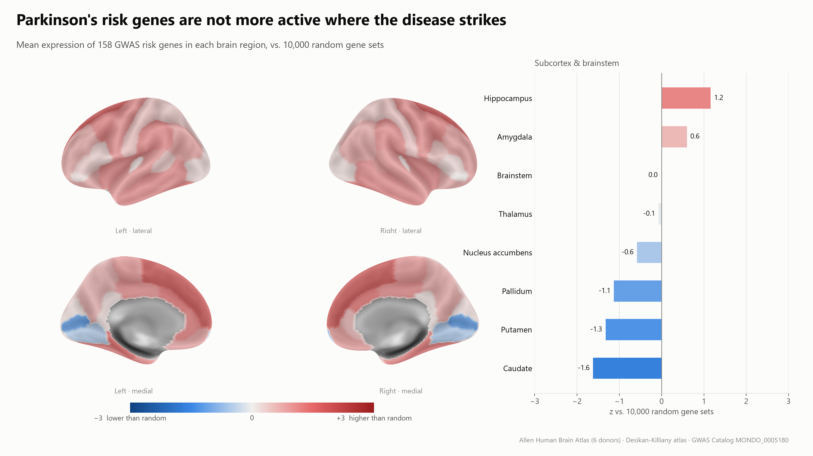
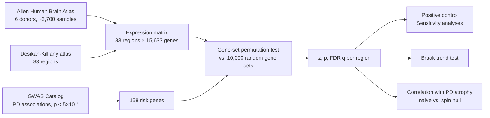
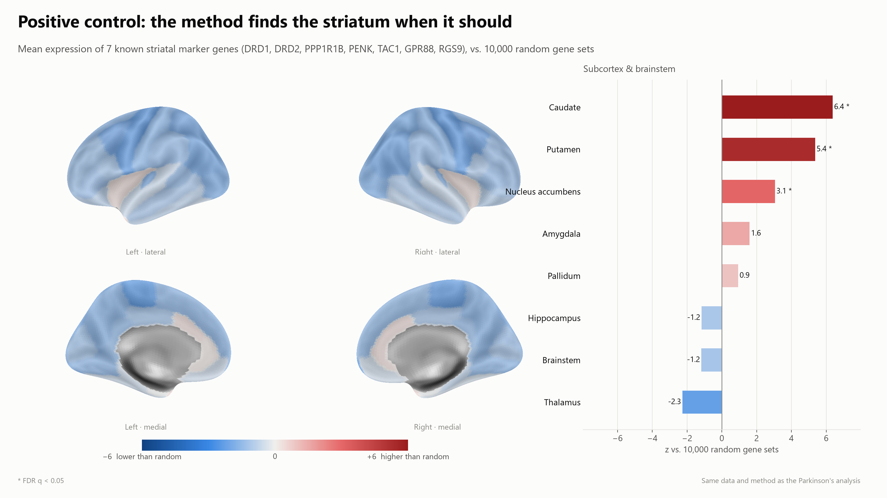
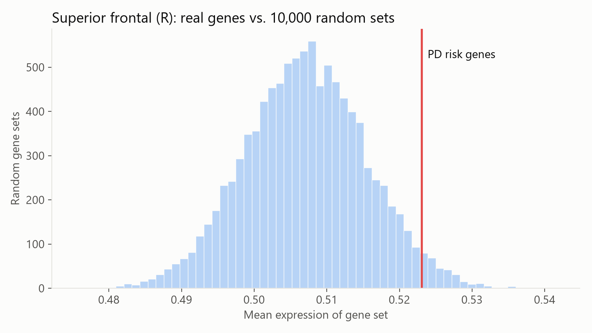
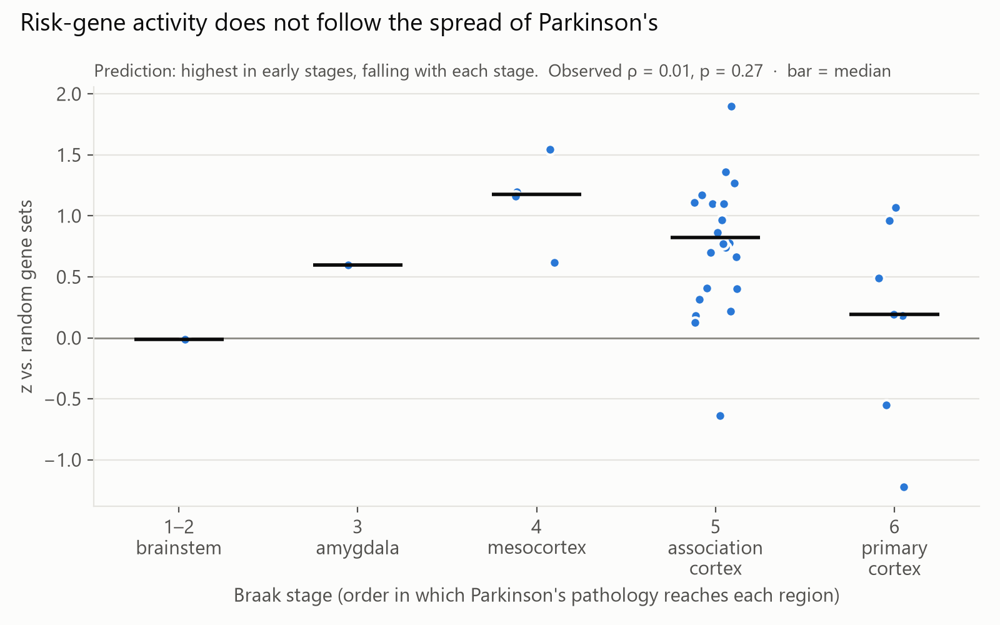
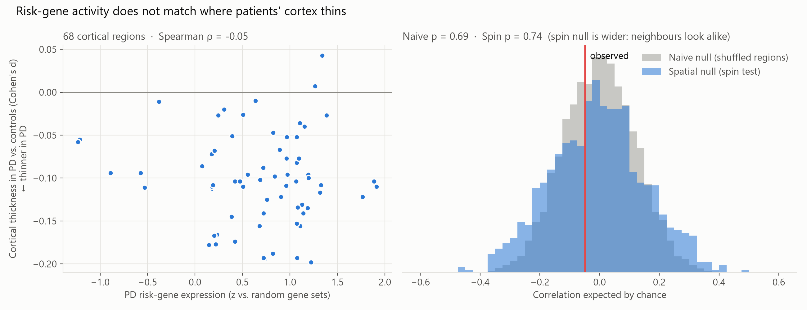

# Are Parkinson's risk genes more active where the disease strikes?

Parkinson's disease (PD) damages specific brain regions first. The dopamine projection to the **striatum** (caudate, putamen) degenerates, and Lewy pathology is thought to begin in the **brainstem**. PD risk genes, however, are carried by every cell. One explanation for this selective vulnerability is that risk genes are **more highly expressed** in the regions that degenerate. This project tests that hypothesis with healthy-brain gene expression from the Allen Human Brain Atlas.



## Key findings

- **No region shows enriched expression of PD risk genes.** 0 of 83 regions pass FDR correction. 3 are nominally significant, against ~4 expected by chance.
- **Regions most affected by PD rank lowest.** Caudate and putamen are at the bottom (z ≈ −1.3 to −1.6), and the brainstem is at z ≈ 0.
- **Expression does not follow Braak staging.** There is no decreasing trend across stages 1–6 (Spearman ρ = 0.01, p = 0.27).
- **Expression does not match PD cortical thinning.** Against ENIGMA-PD effect sizes, ρ = −0.05 (naive p = 0.69, spin-test p = 0.74).
- **The method detects true signals.** A positive control of striatal marker genes ranks caudate and putamen first (z ≈ 5–6).
- **The result is robust.** It holds after removing the MHC, MAPT and LRRK2 loci, and after leaving out each of 93 loci in turn.

**Conclusion:** in healthy adult brains, regional expression of PD risk genes does not explain which regions the disease affects. This is consistent with vulnerability arising at the level of specific cell types (e.g. dopaminergic neurons) rather than whole regions.

---

## Methods



1. **Expression data.** Microarray data from the [Allen Human Brain Atlas](https://human.brain-map.org/) (6 donors) were parcellated into the 83-region Desikan-Killiany atlas (68 cortical, 14 subcortical, 1 brainstem) with [`abagen`](https://abagen.readthedocs.io/). abagen's defaults were used, with bidirectional left–right mirroring because only 2 donors have right-hemisphere samples.
2. **Risk genes.** PD risk associations were taken from the [GWAS Catalog](https://www.ebi.ac.uk/gwas/efotraits/MONDO_0005180) (mapped trait "Parkinson disease", p < 5×10⁻⁸). Mapped genes were annotated with HGNC. Only protein-coding genes were kept, and retired symbols were matched through HGNC previous symbols. This gave **158 genes** measured in the expression data, including SNCA, LRRK2, GBA1, MAPT and TMEM175.
3. **Regional score.** For each region, the score is the mean expression of the 158 genes. It is compared with the same statistic for 10,000 random 158-gene sets. Outputs are a z-score, a one-sided permutation p-value, (k+1)/(n+1), and Benjamini–Hochberg FDR across the 83 regions.
4. **Braak trend.** Regions were assigned to Braak stages and averaged across hemispheres (37 regions). The Spearman correlation between stage and score was compared with the same statistic computed for every random gene set.
5. **Atrophy comparison.** Cortical z-scores (68 regions) were correlated with PD cortical thickness effect sizes. Significance was assessed with a naive null (shuffled region labels) and a spatial null (spin test, [`neuromaps`](https://netneurolab.github.io/neuromaps/)).

## Results

### Positive control

Seven striatal medium spiny neuron markers (DRD1, DRD2, PPP1R1B, PENK, TAC1, GPR88, RGS9) were scored with the same pipeline:



| Region (mean of L/R) | z | FDR q |
|---|---|---|
| Caudate | 6.4 | 0.002 |
| Putamen | 5.4 | 0.002 |
| Nucleus accumbens | 3.1 | 0.01 |

### Regional enrichment of PD risk genes

The highest-scoring region (right superior frontal, z = 1.9) is within the range of the random gene-set distribution:



| Region (mean of L/R) | Involvement in PD | z | FDR q |
|---|---|---|---|
| Superior frontal | Late / not typical | 1.90 | 0.45 |
| Entorhinal | Braak stage 4 | 1.19 | 0.45 |
| Hippocampus | Braak stage 4 | 1.16 | 0.45 |
| Amygdala | Braak stage 3 | 0.60 | 0.50 |
| Brainstem | **Braak stages 1–2** | −0.02 | 0.62 |
| Putamen | **Loss of dopaminergic input** | −1.32 | 0.93 |
| Caudate | **Loss of dopaminergic input** | −1.62 | 0.95 |

All 83 regions: [`results/tables/region_scores.csv`](results/tables/region_scores.csv)

### Sensitivity analyses

| Analysis | Result |
|---|---|
| Remove MHC, MAPT and LRRK2 genes (8 genes) | Region ranking unchanged (Spearman ρ = 0.98) |
| Leave out each of 93 loci in turn | Ranking preserved (ρ ≥ 0.93), mean top-10 overlap 86% |
| Highest z across all 94 runs | 2.22, not significant after correction |
| Caudate and putamen | Negative z in every run |

### Braak staging

Lewy pathology follows a stereotyped sequence ([Braak et al., 2003](https://doi.org/10.1016/S0197-4580(02)00065-9)):

1. brainstem (stages 1–2)
2. amygdala and substantia nigra (3)
3. temporal mesocortex (4)
4. association cortex (5)
5. primary sensory and motor cortex (6)

If expression drove vulnerability, scores should decrease with stage.



| Braak stage | Regions | Mean z |
|---|---|---|
| 1–2 Brainstem | 1 | −0.02 |
| 3 Amygdala | 1 | 0.60 |
| 4 Entorhinal, parahippocampal, hippocampus, temporal pole | 4 | 1.13 |
| 5 Association cortex | 24 | 0.78 |
| 6 Primary sensory/motor cortex | 7 | 0.16 |

Scores peak at stage 4 rather than decreasing (ρ = 0.01, one-sided p = 0.27). Basal ganglia and thalamus are not part of the cortical Braak sequence and are excluded.

### Correlation with PD cortical thinning

ENIGMA-PD reported cortical thickness effect sizes (Cohen's d, PD vs. controls) for each Desikan-Killiany region, from 2,367 patients and 1,183 controls ([Laansma et al., 2021](https://doi.org/10.1002/mds.28706), Supplementary Table 2a). The values are in [`data/external/pd_atrophy_dk.csv`](data/external/pd_atrophy_dk.csv). Negative d means thinner cortex in PD.



| Null model | ρ | p (two-sided) | Permutations |
|---|---|---|---|
| Naive (shuffled region labels) | −0.05 | 0.69 | 10,000 |
| Spatial (spin test) | −0.05 | 0.74 | 1,000 |

Brain maps are spatially autocorrelated: neighbouring regions have similar values. Shuffling region labels ignores this, so the naive null is too narrow and its p-values are too small. The spin test ([Alexander-Bloch et al., 2018](https://doi.org/10.1016/j.neuroimage.2018.05.070)) rotates the map on the cortical sphere, which preserves its spatial structure. Here the spin null is ~30% wider than the naive null. The correlation is not significant under either.

The gene-set tests above do not need a spatial null. They permute genes, not regions, so the real and random gene sets are evaluated on the same spatial layout.

## Comparison with prior work

- **Freeze et al. (2018)** related AHBA expression of PD GWAS genes to PPMI atrophy maps. Only a few genes (LAG3, RAB5A) predicted regional atrophy; most PD genes did not.
- **Reynolds et al. (2019)** found that PD heritability is not enriched in brain-region or brain cell-type annotations. They suggest the risk loci act through processes shared across many cell types.
- **Keo et al. (2020)** used finer AHBA regions along the Braak sequence, including the substantia nigra and locus coeruleus. They found individual GWAS genes (e.g. SNCA, SCARB2) with stage-related expression. This project tests the gene set as a whole on a coarser atlas, so the two results are compatible.
- **Bryois et al. (2020)** linked PD genetic risk to specific cell types: monoaminergic and cholinergic neurons, enteric neurons and oligodendrocytes.

## Limitations

- **Six donors.** The AHBA donors did not have PD. Expression in healthy brains may not reflect expression during disease.
- **Hemisphere mirroring.** Mirroring makes left and right hemispheres nearly identical (r = 0.98).
- **No substantia nigra.** Desikan-Killiany has a single brainstem region.
- **Regional averages.** Each region mixes many cell types. A signal confined to one cell type, such as dopaminergic neurons, can be diluted.
- **Nearest-gene mapping.** A GWAS signal near a gene does not establish that gene as causal. 26 protein-coding genes had no probe in the expression data.
- **Gene co-expression.** Random gene sets do not preserve co-expression structure, which can make the null too narrow. This would inflate false positives, so it does not undermine a null result.
- **Coarse Braak mapping.** Stages 1–2 and 3 are each represented by a single region.

## Reproduce

Requires Python 3.11 and ~4.5 GB of disk space.

```powershell
python -m venv .venv
.venv\Scripts\python.exe -m pip install -r requirements.txt
.venv\Scripts\python.exe run_pipeline.py
```

The first run downloads the Allen Human Brain Atlas (~4 GB) to `data/raw/`. Later runs take about a minute. All random procedures use a fixed seed, so the outputs are deterministic. The GWAS Catalog snapshot used for these results is at [`data/raw/gwas_pd_associations.tsv`](data/raw/gwas_pd_associations.tsv).

## Repository structure

```
├── run_pipeline.py          # runs the full analysis
├── requirements.txt
├── src/
│   ├── config.py            # paths and analysis parameters
│   ├── fetch_expression.py  # AHBA expression -> 83 regions x genes
│   ├── fetch_gwas.py        # GWAS associations -> risk gene list
│   ├── score_regions.py     # gene-set permutation test, FDR, sensitivity analyses
│   ├── braak.py             # Braak staging trend test
│   ├── spatial_test.py      # atrophy correlation with naive and spin nulls
│   └── plots.py             # figures
├── data/
│   ├── raw/                 # GWAS Catalog snapshot
│   └── external/            # ENIGMA-PD cortical thickness effect sizes
├── results/tables/
└── figures/
```

## References

- Hawrylycz MJ et al. (2012). An anatomically comprehensive atlas of the adult human brain transcriptome. *Nature*.
- Markello RD et al. (2021). Standardizing workflows in imaging transcriptomics with the abagen toolbox. *eLife*.
- Desikan RS et al. (2006). An automated labeling system for subdividing the human cerebral cortex on MRI scans into gyral based regions of interest. *NeuroImage*.
- Sollis E et al. (2023). The NHGRI-EBI GWAS Catalog. *Nucleic Acids Research*.
- Braak H et al. (2003). Staging of brain pathology related to sporadic Parkinson's disease. *Neurobiology of Aging*.
- Laansma MA et al. (2021). International multicenter analysis of brain structure across clinical stages of Parkinson's disease. *Movement Disorders*.
- Alexander-Bloch AF et al. (2018). On testing for spatial correspondence between maps of human brain structure and function. *NeuroImage*.
- Markello RD & Mišić B (2021). Comparing spatial null models for brain maps. *NeuroImage*.
- Freeze B et al. (2018). Regional expression of genes mediating trans-synaptic alpha-synuclein transfer predicts regional atrophy in Parkinson disease. *NeuroImage: Clinical*.
- Reynolds RH et al. (2019). Moving beyond neurons: the role of cell type-specific gene regulation in Parkinson's disease heritability. *npj Parkinson's Disease*.
- Keo A et al. (2020). Transcriptomic signatures of brain regional vulnerability to Parkinson's disease. *Communications Biology*.
- Bryois J et al. (2020). Genetic identification of cell types underlying brain complex traits yields insights into the etiology of Parkinson's disease. *Nature Genetics*.
